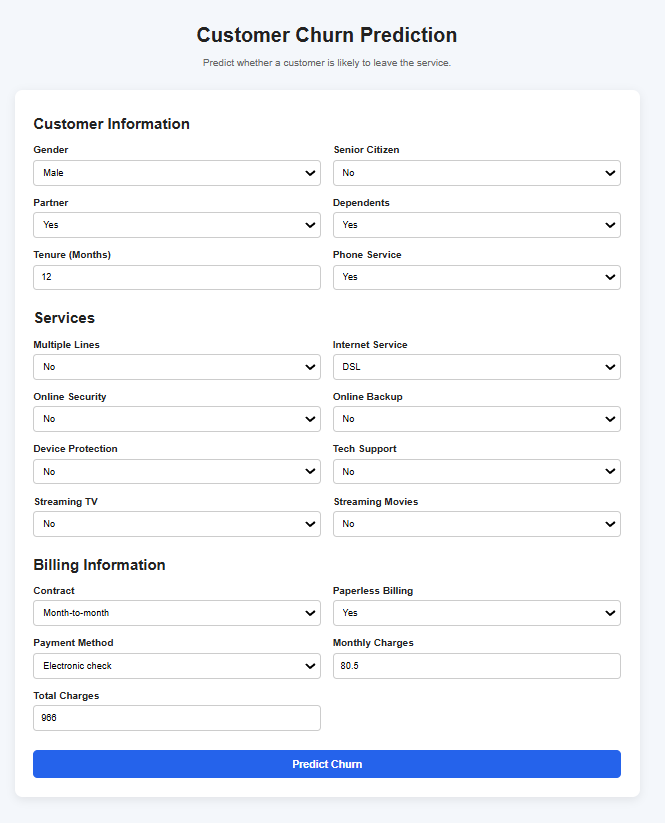
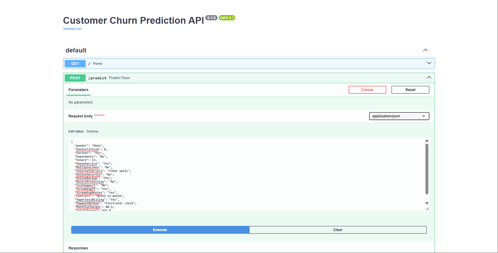
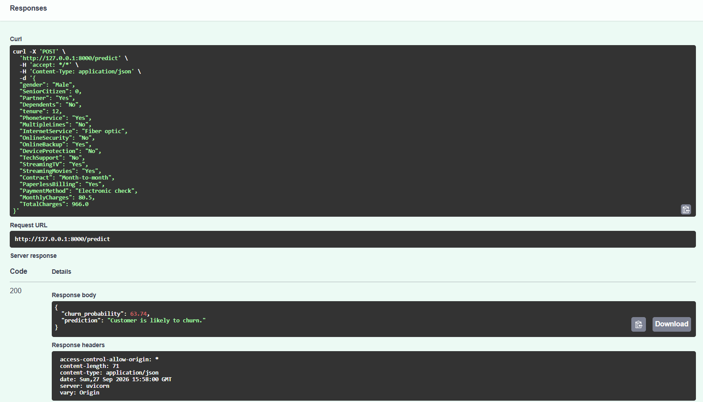

# 🔍 Customer Churn Prediction

An end-to-end Machine Learning project that predicts whether a customer is likely to churn based on their service, contract, and billing information.

## 🚀 Features

- 🧹 Data cleaning & preprocessing
- 🔄 One-Hot Encoding & feature scaling
- 🤖 Logistic Regression
- 🌲 Random Forest & hyperparameter tuning
- 📊 Accuracy, Precision, Recall & F1 Score
- 🔁 5-Fold Cross-Validation
- 🔎 Feature interpretation
- 💾 Model saving with Joblib
- ⚡ FastAPI backend
- 🌐 Interactive web interface
- 📈 Churn probability prediction

## 🧠 ML Pipeline

```text
Raw Data
   ↓
Data Cleaning
   ↓
Train/Test Split
   ↓
ColumnTransformer
   ├── StandardScaler
   └── OneHotEncoder
   ↓
Logistic Regression
   ↓
Evaluation & Cross-Validation
   ↓
Saved Model
   ↓
FastAPI
   ↓
Web Interface
````

## 📊 Dataset

IBM Telco Customer Churn dataset containing customer demographics, services, contracts, payment methods and billing information.

Target:

```text
No  → 0 → Customer stays
Yes → 1 → Customer churns
```

## 🌐 Application

Users can enter customer information through the web interface and receive:

- Churn probability
- Churn / Stay prediction

### 📸 Screenshots

#### 🖥️ Prediction Form


#### 📊 Prediction Result


#### ⚡ FastAPI Swagger


#### ✅ API Response



## 🛠️ Tech Stack

* Python
* Pandas
* Scikit-learn
* Joblib
* FastAPI
* Pydantic
* HTML
* CSS
* JavaScript

## 📁 Project Structure

Customer Churn Prediction/
├── data/
│   └── Telco-Customer-Churn.csv
│
├── models/
│   └── churn_model.joblib
│
├── src/
│   ├── data_inspection.py
│   ├── data_preprocessing.py
│   ├── predict_churn.py
│   └── app.py
│
├── frontend/
│   ├── index.html
│   ├── style.css
│   ├── script.js
│   └── favicon.png
│
├── screenshots/
│
├── README.md
├── requirements.txt
└── .gitignore

## ▶️ Run Locally

Install dependencies:

```bash
pip install -r requirements.txt
```

Start the FastAPI server:

```bash
python -m uvicorn src.app:app --reload
```

API documentation:

http://127.0.0.1:8000/docs

Open `frontend/index.html` to use the web interface.

## 👨‍💻 Author

**Sommay Paliwal**

Built as a practical Machine Learning project covering the workflow from raw data to a complete ML application.